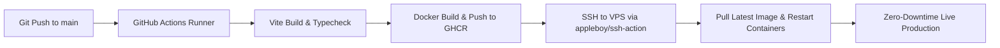

# Try Sereyvichea — Developer Portfolio & Systems Showcase

<div align="center">

# 🚀 Try Sereyvichea (ទ្រី សេរីវិជ្ជា)
### Full-Stack Software Engineer & System Architect
**Phnom Penh, Cambodia**

[](https://github.com/sereyvichea2828/portfolio-chea/actions/workflows/deploy.yml)
[](https://www.docker.com/)
[](https://vuejs.org/)
[](https://www.typescriptlang.org/)
[](https://tailwindcss.com/)
[](LICENSE)

<br />

**[🌐 Portfolio](https://ite.dytetech.com)** • **[🎓 Student Portal](https://ite.dytetech.com)** • **[🧮 Math Optimizer](https://math.dytetech.com)** • **[💼 LinkedIn](https://www.linkedin.com/in/try-sereyvichea-8a890a436/)** • **[📫 Email Me](mailto:dyte.vichea.dev@gmail.com)**

</div>

---

## 📌 Executive Summary

Welcome to the engineering repository for my personal developer portfolio and distributed digital ecosystems. 

Designed and engineered from first principles with **Vue 3**, **Tailwind CSS v4**, **TypeScript**, and **Three.js**, this portfolio is not a prefabricated template. It serves as an interactive production platform demonstrating modern frontend architecture, cinematic motion design, WebGL shader interactions, genuine academic credentials, and automated containerized deployment pipelines.

---

## 🌐 Live Sites & Deployed Ecosystem

Below is the directory of all live digital platforms, production systems, and engineering projects deployed and maintained across my infrastructure:

| Platform / Service | Domain & Live URL | Status | Core Technologies | Description |
| :--- | :--- | :--- | :--- | :--- |
| **ITE A3 Ecosystem** *(Student Portal)* | [ite.dytetech.com](https://ite.dytetech.com) | 🟢 **Live** (Port 80) | Vue 3, Node.js, WebSockets, GPS Math, MongoDB | Academic operations platform with anti-spoof GPS attendance verification (±50m) and automated duty shifts. |
| **Faculty Suite** *(Admin Dashboard)* | `Internal Admin Portal` | 🟢 **Active** (Port 8081) | Node.js, Express, RBAC, Automated Reporting | Comprehensive cohort administration, scheduling engine, and faculty attendance monitoring. |
| **Healthcare Optimizer** *(Linear Systems)* | [math.dytetech.com](https://math.dytetech.com) • [Repo](https://github.com/sereyvichea2828/math-project) | 🟢 **Live** | Vue 3, Numerical Linear Algebra, WebAssembly | Scientific linear systems optimizer solving $A^T A x = A^T b$ via Gaussian Elimination ($O(n^3)$) with $10^{-10}$ epsilon precision. |
| **Personal Developer Portfolio** | [ite.dytetech.com](https://ite.dytetech.com) • [Repo](https://github.com/sereyvichea2828/portfolio-chea) | 🟢 **Live** (Port 8082) | Vue 3.5, Vite 8, Three.js, GSAP, Nginx Alpine | Cinematic, high-performance portfolio featuring WebGL interactive waves, full-width scroll transitions, and Khmer typography. |
| **Lecturer / Academic Partner** | [tfdevs.com](https://tfdevs.com/) | 🟢 **Official** | Teaching For Development (TFDevs) | Official institution of instructor Chau Dara. Verified credential: DevOps Essential (`TFD-2026-000054`). |

---

## 🏗️ VPS Infrastructure & Port Topology

All services are orchestrated on a Linux VPS with Docker Compose, segregated via an isolated internal bridge network (`proxy-net`) behind an Nginx reverse proxy with SSL termination:

```
                          Internet / Clients
                                  │
                                  ▼
                    ┌───────────────────────────┐
                    │  Nginx Host Reverse Proxy  │
                    │   (SSL / Certbot / TLS)   │
                    └─────────────┬─────────────┘
                                  │
         ┌────────────────────────┼────────────────────────┐
         │ :80                    │ :8081                  │ :8082
         ▼                        ▼                        ▼
┌──────────────────┐    ┌──────────────────┐    ┌──────────────────┐
│  Student Portal  │    │  Faculty Suite   │    │  Portfolio App   │
│   (ITE A3 Hub)   │    │ (Admin Portal)   │    │ (portfolio-chea) │
│  Container :80   │    │ Container :8081  │    │ Container :80    │
└──────────────────┘    └──────────────────┘    └──────────────────┘
```

| Container / App | Host Port | Internal Container Port | Reverse Proxy Target | Network |
| :--- | :--- | :--- | :--- | :--- |
| **Student Portal** | `80` / `443` | `80` | `http://127.0.0.1:80` (`ite.dytetech.com`) | `proxy-net` |
| **Faculty Suite** | `8081` | `8081` | `http://127.0.0.1:8081` | `proxy-net` |
| **Developer Portfolio** | `8082` | `80` | `http://127.0.0.1:8082` | `proxy-net` |

---

## ✨ Engineering Highlights & Core Features

### 1. Interactive WebGL Liquid Shader
- Custom fragment and vertex shaders developed with Three.js rendering dynamic water ripples and cursor physics.
- Respects accessibility standards (`prefers-reduced-motion`) and automatically pauses when idle to preserve GPU and battery life.

### 2. Edge-to-Edge Responsive Header Navigation
- At the top of the viewport (`scrollY <= 15`): Renders as a refined floating card aligned with the 6xl content grid.
- Upon scrolling: Seamlessly expands into an agency-grade, full-width sticky navigation bar (`w-full px-4 sm:px-6 lg:px-8`) with backdrop blur, perfectly matching the footer's width and alignment.

### 3. Authentic Credential Showcase & Document Lightbox
- Features genuine verified certificates from **TFDevs** (DevOps Essential — Credential ID: `TFD-2026-000054`).
- Interactive modal viewer supporting high-resolution document previews and direct one-click PDF downloads.
- Direct attribution and link to the lecturer's platform ([tfdevs.com](https://tfdevs.com/)).

### 4. Native Khmer Typography & Editorial Design
- Purpose-built typographic hierarchy supporting **Kantumruy Pro** and **Koulen** with calibrated vertical line heights (`1.65` body, `1.35` headings) to prevent vowel and sub-consonant clipping across all screen sizes.
- Editorial Light Theme design language with strict adherence to a unified color system (`#0F172A` deep ink, `#FFFFFF` surfaces, `#F7F7FB` pearl canvas, `#6366F1` indigo accents).

### 5. Multi-Layer Linter & Quality Assurance
- Ultra-fast Rust-based **oxlint** paired with **ESLint 10** and **Prettier** for instantaneous syntax checks, zero runtime warnings, and strict code formatting.

---

## 🛠️ Complete Tech Stack

| Domain | Technologies |
| :--- | :--- |
| **Core Framework** | **Vue 3.5** (Composition API, `<script setup>`), **TypeScript 7.0** |
| **Build & Tooling** | **Vite 8.2**, Rollup Chunk Splitting, Vite Plugin Vue |
| **Styling & Design System** | **Tailwind CSS v4** (`@tailwindcss/vite`), Custom CSS Design Tokens |
| **Motion & Physics** | **Three.js** (WebGL GLSL Shaders), **GSAP 3.15** (ScrollTrigger), **Lenis 1.3** |
| **State & Routing** | **Pinia 4**, **Vue Router 5** (History Mode, Pan Transitions) |
| **Typography & Icons** | **Kantumruy Pro**, **Plus Jakarta Sans**, **Lucide Vue Next**, **Simple Icons** |
| **Container & Hosting** | **Docker** (Multi-stage build), **Nginx 1.27 Alpine**, **Linux / Bash** |
| **CI/CD Automation** | **GitHub Actions**, **GitHub Container Registry (GHCR)**, **Appleboy SSH** |

---

## 🚀 Quick Start (Local Development)

### Prerequisites

- **Node.js:** `^22.18.0` or `>=24.12.0`
- **Package Manager:** `npm` (v10+) or `bun`

### Setup Steps

```bash
# 1. Clone the repository
git clone https://github.com/sereyvichea2828/portfolio-chea.git
cd portfolio-chea

# 2. Install dependencies
npm install

# 3. Start local development server (with HMR)
npm run dev
```

The application will be accessible at `http://localhost:5173`. No third-party environment variables are required for development mode.

---

## 🐳 Docker Containerization

### 1. Development Container (Hot Reloading)

Mounts your local codebase into a live container with instantaneous Vite HMR:

```bash
npm run docker:dev
# or: docker compose -f docker-compose.dev.yml up --build
```
Access at `http://localhost:5173`.

### 2. Production Container (Nginx Alpine)

Compiles an optimized production bundle and serves it via a locked-down, multi-stage Nginx Alpine container (<30MB total footprint):

```bash
npm run docker:prod
# or: docker compose -f docker-compose.prod.yml up --build -d
```

### 3. Container Management

```bash
# Check container status and health checks
docker compose ps

# View live container logs
docker compose logs -f

# Gracefully stop the stack
npm run docker:down
```

---

## 🤖 CI/CD Automation Pipeline

Continuous Deployment is handled automatically via `.github/workflows/deploy.yml`:



1. **Trigger:** Every `git push` to the `main` branch.
2. **Build:** Compiles Vue 3 assets and packages the production Docker image.
3. **Registry:** Pushes image with commit SHA & `latest` tag to `ghcr.io/sereyvichea2828/portfolio-chea`.
4. **Deploy:** Securely authenticates with the VPS via SSH private key, pulls the latest image, and restarts the service with zero downtime.

---

## 📜 Available NPM Scripts

| Command | Description |
| :--- | :--- |
| `npm run dev` | Launches the local Vite development server on port `5173`. |
| `npm run build` | Compiles TypeScript and builds optimized production assets into `/dist`. |
| `npm run preview` | Locally serves and tests the production `/dist` bundle. |
| `npm run type-check` | Runs `tsc --noEmit` to validate all TypeScript types strictly. |
| `npm run lint:oxlint` | Executes high-speed Rust-based linting on all files. |
| `npm run lint:eslint` | Runs ESLint with automated fixes and caching. |
| `npm run lint` | Runs both `oxlint` and `eslint` concurrently. |
| `npm run format` | Formats all source code with Prettier. |
| `npm run docker:dev` | Spawns the Docker Compose development stack with hot-reloading. |
| `npm run docker:prod` | Builds and launches the background production Nginx container. |
| `npm run docker:down` | Gracefully terminates and removes active Docker Compose containers. |

---

## 📁 Repository Structure

```text
portfolio-chea/
├── .github/
│   └── workflows/
│       └── deploy.yml            # Automated CI/CD deployment pipeline
├── public/
│   ├── certificates/             # Genuine certificate images and PDFs
│   ├── images/projects/          # High-resolution project showcase assets
│   ├── favicon.ico
│   └── robots.txt
├── src/
│   ├── assets/
│   │   ├── main.css              # Calibrated design tokens & Khmer typography rules
│   │   └── icons/                # Vector brand & technical icons
│   ├── components/
│   │   ├── mockups/              # Interactive embedded UI project mockups
│   │   │   ├── CampusMockup.vue  # ITE A3 campus portal preview
│   │   │   └── MathMockup.vue    # Linear systems solver preview
│   │   ├── AboutSection.vue      # Developer biography & core engineering principles
│   │   ├── AppFooter.vue         # Full-width responsive footer
│   │   ├── AppNavbar.vue         # Edge-to-edge adaptive header navigation
│   │   ├── ContactSection.vue    # Interactive contact form & verified links
│   │   ├── ExperienceSection.vue # Timeline & genuine certificate showcase
│   │   ├── HeroSection.vue       # Executive greeting & portrait showcase
│   │   ├── LiquidBackground.vue  # Interactive Three.js WebGL fluid canvas
│   │   ├── ProcessSection.vue    # Five-stage development methodology
│   │   ├── ProjectsSection.vue   # Filterable featured systems gallery
│   │   ├── ResumeModal.vue       # Interactive CV previewer & downloader
│   │   └── SkillsSection.vue     # Full-stack categorized technology matrix
│   ├── composables/              # Lenis smooth scroll, GSAP triggers, WebGL interactions
│   ├── data/                     # Typed data sources & verified project details
│   ├── router/                   # Vue Router navigation & route pan animations
│   ├── types/                    # Domain TypeScript interface contracts
│   ├── App.vue                   # Root layout container
│   └── main.ts                   # Application bootstrap & plugin registration
├── docker-compose.dev.yml        # Development Docker Compose file
├── docker-compose.prod.yml       # Production Docker Compose file
├── docker-compose.yml            # Primary Docker Compose configuration
├── Dockerfile                    # Multi-stage production container build
├── nginx.conf                    # Nginx caching, compression & SPA fallback routing
├── package.json                  # Dependencies & scripts
├── tsconfig.json                 # TypeScript compiler configuration
└── vite.config.ts                # Vite 8 & Tailwind v4 plugin setup
```

---

## 📬 Contact & Connect

- **Engineer:** Try Sereyvichea (ទ្រី សេរីវិជ្ជា)
- **Email:** [dyte.vichea.dev@gmail.com](mailto:dyte.vichea.dev@gmail.com)
- **LinkedIn:** [linkedin.com/in/try-sereyvichea-8a890a436](https://www.linkedin.com/in/try-sereyvichea-8a890a436/)
- **GitHub:** [@sereyvichea2828](https://github.com/sereyvichea2828)
- **Location:** Phnom Penh, Cambodia

---

## 📄 License

This repository is distributed under the [MIT License](LICENSE). You are welcome to inspect, reference, and learn from the architecture.
